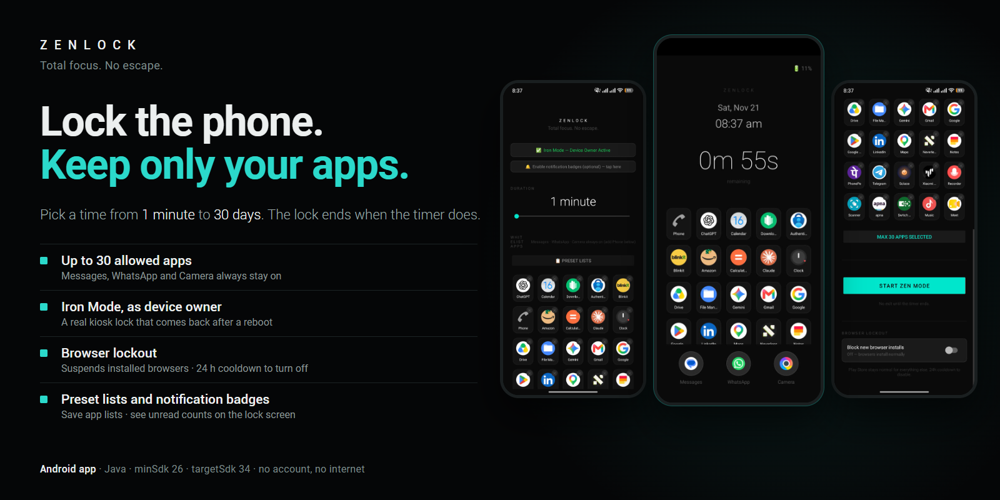
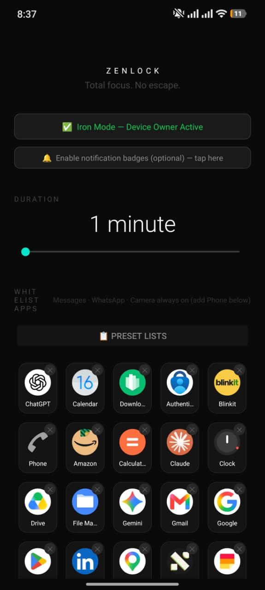
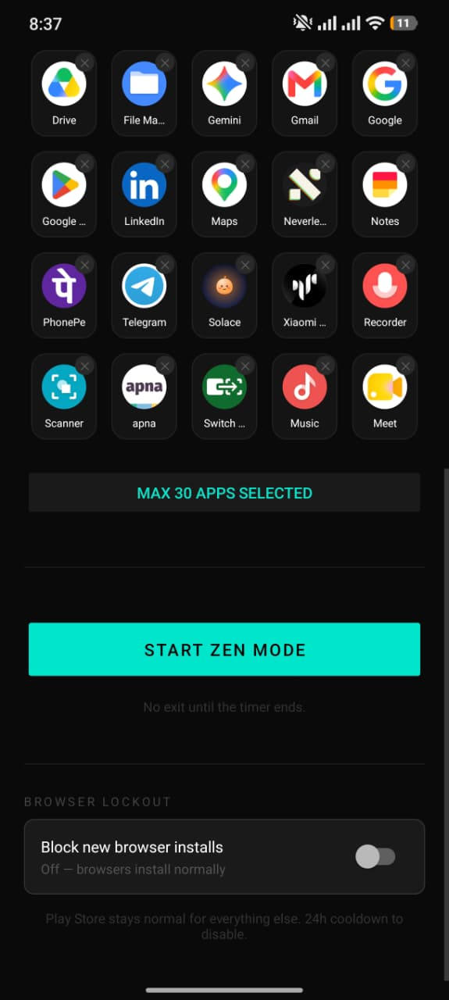
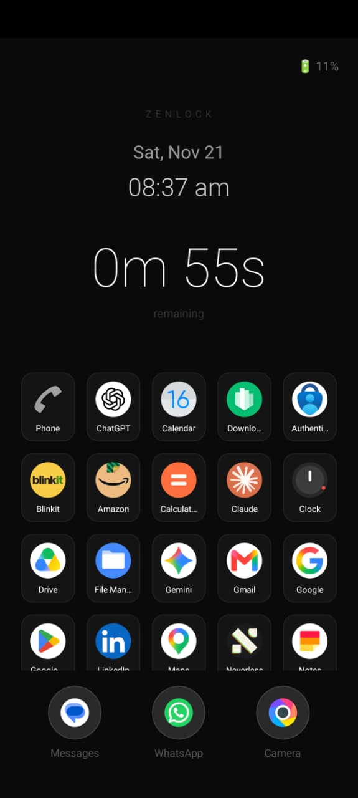

# ZenLock

**Total focus. No escape.** ZenLock is an Android app that locks your phone for a time you pick, from 1 minute to 30 days. During that time you can open only the apps you chose. The lock ends when the timer ends, and not before.

  
  

## Before you install

ZenLock is strict on purpose. Read these points first.

- **You cannot end a session early.** There is no exit button and no password. A reboot does not end it: the lock comes back after the phone starts.
- **Messages, WhatsApp and Camera always stay open.** The Phone button appears only if you add your phone app to the list. Add it if you may need to make calls.
- **Iron Mode makes ZenLock the device owner.** Android does not let you remove a device owner from this app. Today, the only way back is a factory reset.
- **Browser lockout is not undone by the app.** Turning it off starts a 24-hour cooldown, but the app does not unsuspend the browsers it suspended.

## The app

<table>
  <tr>
    <td width="33%"></td>
    <td width="33%"></td>
    <td width="33%"></td>
  </tr>
  <tr>
    <td><b>Set up.</b> Pick a time: 1 to 45 minutes, 1 to 24 hours, or 1 to 30 days. Load a saved list of apps.</td>
    <td><b>Pick your apps.</b> Up to 30. Save the list as a preset for next time.</td>
    <td><b>Locked.</b> The countdown, your apps, and the 3 apps that are always on. Optional badges show unread counts.</td>
  </tr>
</table>

## How it works

- **Lock screen:** ZenLock pins its own screen and blocks the Home, Back, Recents and volume keys.
- **Watcher:** a foreground service checks the app in front every half second. If it is not allowed for about 5 seconds, ZenLock comes back.
- **Iron Mode:** as device owner, ZenLock uses Android's real kiosk mode (lock task). Without device owner, Android allows only screen pinning, which is easier to leave.
- **After a reboot:** a boot receiver restarts the lock if a session is still running. Settings are kept in device-protected storage, so this works before the first unlock.
- **Browser lockout (device owner only):** suspends every installed browser from a list of about 95 browsers.
- **Notification badges (optional):** counts unread notifications for Messages, WhatsApp and Phone.
- **Privacy:** ZenLock has no account and no internet permission. Nothing leaves the phone.

### Permissions

| Permission | Why |
|---|---|
| Usage access | To see which app is in front |
| Device admin, or device owner for Iron Mode | To lock the screen and to suspend browsers |
| Notification access (optional) | For the unread badges |
| Run at startup | To lock again after a reboot |
| Foreground service | For the watcher |
| See all apps | To list your apps and find browsers and the phone app |

## Set up Iron Mode

Iron Mode needs a phone with no accounts on it (Google and others), or a freshly reset phone. Read "Before you install" first.

1. Install ZenLock.
2. Turn on USB debugging and connect the phone to a computer.
3. Run: `adb shell dpm set-device-owner com.dheekshith.zenlock/.ZenDeviceAdminReceiver`
4. Open ZenLock. It shows "Iron Mode — Device Owner Active".

Without Iron Mode, allow device admin, usage access and (optionally) notification access when ZenLock asks.

## Status of the code

The original source was lost. The code here was recovered from the version 12 APK with a decompiler, so the Java files are tool output (the original app was written in Kotlin). The build file does not list the libraries yet, so the project does not build as it is.

Next step: a clean rebuild in Kotlin from this recovered code, with the same behaviour and tests for each feature, and a safe way to remove device owner.

## Built with

Android (minSdk 26, targetSdk 34), Java (recovered), Android Gradle Plugin 8.10.

## Contributing

Ideas and bug reports are welcome: read [CONTRIBUTING.md](./CONTRIBUTING.md). For a security problem, follow [SECURITY.md](./SECURITY.md).

## License

[MIT](./LICENSE).
